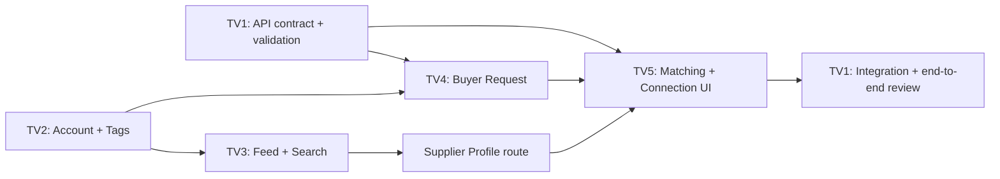

# TRADEVIA — Kế hoạch công việc còn lại

Tài liệu này phản ánh các file hiện có tại thời điểm rà soát. Mục tiêu là hoàn thiện demo MVP chạy trên localhost theo luồng:

```text
Demo login → Feed theo tag → Supplier profile → Buyer request
→ Matching results → Connection request
```

## 1. Hiện trạng đã kiểm tra

| Khu vực | Trạng thái | Bằng chứng |
|---|---|---|
| Frontend foundation | Có React + Vite và một trang giới thiệu tĩnh | `client/src/App.jsx` |
| Frontend build | Đạt | `npm run build` hoàn thành thành công |
| Backend API | Có health, suppliers, requests, matching và connections | `server/src/app.js` |
| Data storage | Có JSON file đọc/ghi local | `server/data/`, `server/src/utils/storage.js` |
| Matching service | Có rule-based matching theo trọng số đã thống nhất | `server/src/services/matchingService.js` |
| Matching unit test | Đạt 11/11 test | `server/src/tests/matching.test.js` |
| Supplier seed data | Có 4 supplier mẫu | `server/data/suppliers.json` |
| Buyer request seed data | Có 1 request mẫu | `server/data/requests.json` |
| Connection seed data | Có 1 connection mẫu | `server/data/connections.json` |

### Những phần chưa tồn tại

- Mock login, personal account và business account.
- Business profile, industry tag selector và dữ liệu account.
- Post data, feed theo tag và tìm kiếm doanh nghiệp.
- Supplier profile UI và Buyer Request form UI.
- Matching result UI, connection UI và toàn bộ liên kết frontend với API.
- API integration test và kiểm thử luồng demo end-to-end.

## 2. Phân công và phạm vi file

| Thành viên | Vai trò | Thư mục/module sở hữu | Branch đề xuất |
|---|---|---|---|
| 1 | Lead Developer + Backend | `server/`, API contract, integration | `backend` hoặc `feature/backend-matching` |
| 2 | Account & Industry Tags | `client/src/modules/account/` | `feature/account` |
| 3 | Feed & Search | `client/src/modules/feed/` | `feature/feed` |
| 4 | Supplier Profile & Buyer Request | `client/src/modules/suppliers/`, `client/src/modules/requests/` | `feature/supplier-request` |
| 5 | Matching UI, Connections & QA | `client/src/modules/matching/`, `client/src/modules/connections/` | `feature/matching-connection` |

Không thành viên nào tự sửa `client/src/App.jsx`, `client/src/main.jsx`, `client/package.json`, `server/package.json`, API data contract hoặc stylesheet chung nếu chưa được Thành viên 1 thống nhất. Khi cần tích hợp, Thành viên 1 thực hiện hoặc phân công rõ commit cần thay đổi file dùng chung.

---

## 3. Thành viên 1 — Backend & Lead Developer

### Mục tiêu

Đảm bảo backend cung cấp API ổn định, dữ liệu hợp lệ, matching minh bạch và đủ điều kiện để bốn frontend module tích hợp song song.

### 3.1. Việc cần làm ngay: sửa scoring location

**Hiện trạng:** request mẫu có `location: "Vietnam"`, còn supplier mẫu dùng chuỗi như `"Ho Chi Minh City, Vietnam"`. Hàm nhận diện địa điểm hiện chỉ tra cả chuỗi chính xác, nên supplier cùng Việt Nam đang nhận điểm location là `0`.

**Cần thực hiện:**

- Chuẩn hóa location dạng `"thành phố, quốc gia"` trước khi tra `PLACE_LOOKUP`.
- Nhận diện `Vietnam` và `Ho Chi Minh City, Vietnam` là cùng quốc gia.
- Giữ nguyên quy tắc điểm:
  - Cùng thành phố: 100.
  - Cùng quốc gia khác thành phố: 75.
  - Khác quốc gia: 0.
- Bổ sung test cho địa chỉ có hậu tố quốc gia, ví dụ `Vietnam` với `Da Nang, Vietnam`.

**File dự kiến:**

- `server/src/services/matchingService.js`
- `server/src/services/matchingConfig.js` nếu cần mở rộng bảng địa điểm
- `server/src/tests/matching.test.js`

**Hoàn thành khi:** matching cho `request-001` trả location score 75 cho các supplier ở Việt Nam nhưng khác thành phố.

### 3.2. Hoàn thiện validation của Buyer Request API

Endpoint hiện có: `POST /api/requests`.

**Cần thực hiện:**

- Bắt buộc `buyerId`, `title`, `industryTags`, `requiredServices`, `desiredCapacity`, `location` và `businessModel`.
- Xác minh `industryTags`, `requiredServices`, `complianceRequirements` là mảng string hợp lệ.
- Không chấp nhận mảng rỗng ở các trường bắt buộc.
- Giới hạn và trim các chuỗi nhập từ frontend.
- Trả HTTP 400 cùng danh sách trường lỗi rõ ràng.
- Giữ tên field camelCase đúng Starter Pack.

**File dự kiến:**

- `server/src/app.js`
- Có thể thêm `server/src/utils/validation.js`
- Thêm test API cho request hợp lệ và các request không hợp lệ

**Hoàn thành khi:** form frontend gửi dữ liệu sai nhận lỗi có thể hiển thị được theo từng field; dữ liệu hợp lệ được ghi JSON với ID mới.

### 3.3. Hoàn thiện validation của Connection API

Endpoint hiện có: `POST /api/connections`.

**Cần thực hiện:**

- Kiểm tra `requestId` tồn tại trong `requests.json`.
- Kiểm tra `supplierId` tồn tại trong `suppliers.json`.
- Xác minh `buyerId` trùng với `buyerId` thuộc buyer request.
- Giữ kiểm tra duplicate theo `requestId + supplierId`.
- Trả 404 khi request/supplier không tồn tại; trả 400 khi buyer không phù hợp; trả 409 khi trùng kết nối.

**File dự kiến:**

- `server/src/app.js`
- Test API mới trong `server/src/tests/`

**Hoàn thành khi:** frontend có thể phân biệt lỗi nhập sai, ID không tồn tại và connection đã được tạo.

### 3.4. Bổ sung kiểm thử endpoint và luồng API

Unit test hiện chỉ kiểm tra matching service, chưa khởi động Express app để kiểm tra route HTTP.

**Cần thực hiện:**

- Tách Express app khỏi phần `listen()` để test route mà không cần mở port thật.
- Test `GET /api/health`, supplier list/detail, request list/create, matching và connection list/create.
- Có test cho mã 200, 201, 400, 404 và 409 theo các tình huống ở trên.
- Không để test làm thay đổi vĩnh viễn seed data; dùng fixture hoặc temporary test data.

**File dự kiến:**

- `server/src/app.js` hoặc tách thành `server/src/createApp.js`
- `server/src/tests/api.test.js`
- `server/src/tests/fixtures/`

**Hoàn thành khi:** `npm test` kiểm tra cả matching logic lẫn API contract mà không làm thay đổi file dữ liệu demo.

### 3.5. Chuẩn hóa API contract và tài liệu

**Cần thực hiện:**

- Cập nhật README vì hiện vẫn mô tả backend như chỉ có health endpoint, trong khi các endpoint khác đã tồn tại.
- Thêm bảng endpoint gồm body input, response thành công, error code và ví dụ curl.
- Xác nhận team sử dụng cùng response shape cho matching:

```json
{
  "requestId": "request-001",
  "results": [
    {
      "supplierId": "supplier-001",
      "score": 98,
      "breakdown": {
        "industryTags": 100,
        "services": 100,
        "capacity": 100,
        "location": 75,
        "compliance": 100,
        "businessModel": 100
      },
      "missingData": []
    }
  ]
}
```

- Chốt cách frontend ánh xạ `missingData` sang nhãn tiếng Việt.

**Hoàn thành khi:** Thành viên 2–5 không cần đoán tên field, cách gọi API hoặc tình huống lỗi.

### 3.6. Nhiệm vụ integration của Lead Developer

- Duyệt thay đổi frontend trước khi merge.
- Kiểm tra không có thành viên sửa package config hoặc file chung ngoài phạm vi.
- Sau mỗi module được merge, chạy frontend build, backend test và luồng API liên quan.
- Giữ dữ liệu seed đủ đa dạng để matching hiển thị kết quả khác nhau.
- Chuẩn bị demo account/request cố định để cả nhóm có thể lặp lại kịch bản trình bày.

---

## 4. Thành viên 2 — Account & Industry Tags

### Mục tiêu

Tạo điểm bắt đầu cho người dùng demo và cung cấp danh sách tag để Feed, Buyer Request và Matching sử dụng thống nhất.

### Phạm vi file

```text
client/src/modules/account/
client/src/data/ (chỉ dữ liệu mock account/tag được phê duyệt)
```

### Việc cần làm

1. Tạo mock login với ít nhất hai tài khoản demo:
   - Business account: một doanh nghiệp có tag chính, ví dụ `electronics` và `manufacturing`.
   - Personal account: một cá nhân có nhiều tag, ví dụ `electronics`, `sourcing`, `product development`.
2. Tạo màn hình chọn tài khoản demo hoặc đăng nhập demo bằng nút có sẵn.
3. Tạo màn hình/profile hiển thị:
   - Account type: `business` hoặc `personal`.
   - Display name.
   - Company name khi là business account.
   - Industry tags.
4. Business account chỉ hiển thị các tag thuộc lĩnh vực doanh nghiệp; personal account có thể chọn nhiều tag.
5. Cho phép chỉnh tag bằng mock state hoặc localStorage, không cần xác thực thật.
6. Xuất context/hook hoặc data adapter để các module khác đọc được current account và selected tags.

### Dữ liệu cần thống nhất với team

```json
{
  "id": "buyer-001",
  "accountType": "business",
  "displayName": "Minh Nguyen",
  "companyName": "TRADEVIA Demo Buyer",
  "industryTags": ["electronics", "manufacturing"]
}
```

### Phụ thuộc

- Chưa cần backend auth.
- Cần thống nhất danh sách tag với Thành viên 3 và 4 trước khi tạo seed data.

### Hoàn thành khi

- Người dùng chọn được một account demo.
- Header/profile hiển thị account và tag.
- Module khác nhận được `currentAccount`, `accountType`, `industryTags` bằng một interface đã ghi rõ.
- Có loading/empty state phù hợp nếu dữ liệu account không có.

---

## 5. Thành viên 3 — Feed & Search

### Mục tiêu

Hiển thị trang chủ có feed bài đăng và doanh nghiệp gợi ý phù hợp với tags của account hiện tại.

### Phạm vi file

```text
client/src/modules/feed/
client/src/data/ (post mock data và adapter riêng)
```

### Việc cần làm

1. Tạo schema dữ liệu bài đăng mock:

```json
{
  "id": "post-001",
  "authorName": "Mekong Circuit Works",
  "authorType": "business",
  "title": "PCB assembly for IoT devices",
  "content": "We support medium-volume electronics manufacturing.",
  "tags": ["electronics", "manufacturing"],
  "createdAt": "2026-11-05T00:00:00.000Z"
}
```

2. Tạo feed ưu tiên các post có tag giao với `currentAccount.industryTags`.
3. Tạo tag filter để người dùng lọc feed theo từng tag.
4. Tạo khu vực gợi ý supplier/doanh nghiệp, dùng `GET /api/suppliers` hoặc mock adapter khi API chưa được gắn.
5. Tạo tìm kiếm theo company name, industry tag và service.
6. Có trạng thái loading, không kết quả và lỗi gọi API.
7. Tạo mỗi post có tags hiển thị rõ và sẵn sàng cho chức năng xem chi tiết supplier.

### Phụ thuộc

- Nhận `currentAccount` và industry tags từ Thành viên 2.
- Có thể dùng `GET /api/suppliers?tag=...` của backend.
- Cần thống nhất đường dẫn hoặc callback mở Supplier Profile với Thành viên 4 và Lead Developer.

### Hoàn thành khi

- Đổi account demo hoặc tag làm nội dung feed/gợi ý thay đổi hợp lý.
- Filter và search không làm lỗi trang khi không có kết quả.
- Người dùng có thể bấm một supplier để vào phần profile sau khi integration.

---

## 6. Thành viên 4 — Supplier Profile & Buyer Request

### Mục tiêu

Cho người dùng xem năng lực supplier và tạo Buyer Request đúng API contract hiện tại.

### Phạm vi file

```text
client/src/modules/suppliers/
client/src/modules/requests/
```

### Việc cần làm: Supplier Profile

1. Lấy danh sách hoặc detail từ:

```text
GET /api/suppliers
GET /api/suppliers/:id
```

2. Hiển thị đầy đủ field hiện có:
   - Company name.
   - Description.
   - Industry tags.
   - Services/capabilities.
   - Business model.
   - Capacity.
   - Location.
   - Certifications.
3. Hiển thị rõ `Not provided` nếu một field supplier chưa được khai báo, ví dụ certifications.
4. Có loading, not-found và error state.

### Việc cần làm: Buyer Request Form

1. Tạo form phù hợp schema `POST /api/requests`:
   - `buyerId`
   - `title`
   - `description`
   - `industryTags`
   - `requiredServices`
   - `desiredCapacity`
   - `location`
   - `complianceRequirements`
   - `businessModel`
2. Tự điền `buyerId`, tags và business model từ account của Thành viên 2 khi phù hợp.
3. Validate trên client trước khi submit; vẫn hiển thị error backend nếu backend từ chối.
4. Sau khi tạo thành công, giữ lại `requestId` trả về để chuyển sang Matching Results.
5. Hiển thị confirmation rõ ràng cùng nút “Xem nhà cung cấp phù hợp”.

### Phụ thuộc

- Contract validation do Thành viên 1 hoàn thiện.
- Account data do Thành viên 2 cung cấp.
- Endpoint `/api/requests` và `/api/suppliers` có sẵn.

### Hoàn thành khi

- Mở được supplier profile từ một item có `supplierId`.
- Submit form đúng tạo request mới qua API, nhận 201 và có `requestId`.
- Các lỗi 400 từ API hiện được cho người dùng theo field hoặc thông báo dễ hiểu.

---

## 7. Thành viên 5 — Matching UI, Connections & QA

### Mục tiêu

Hiển thị kết quả matching một cách giải thích được, cho phép tạo connection và kiểm thử toàn bộ luồng demo.

### Phạm vi file

```text
client/src/modules/matching/
client/src/modules/connections/
docs/qa/ (nếu team thống nhất tạo checklist riêng)
```

### Việc cần làm: Matching Results

1. Nhận `requestId` từ Buyer Request flow.
2. Gọi:

```text
POST /api/matching
{ "requestId": "request-001" }
```

3. Hiển thị supplier theo thứ tự điểm giảm dần.
4. Mỗi result card cần có:
   - Supplier name lấy từ supplier data.
   - Total score 0–100.
   - Breakdown theo sáu tiêu chí.
   - Nhãn tiếng Việt cho `missingData`.
   - Nút xem Supplier Profile.
   - Nút gửi Connection Request.
5. Có trạng thái loading, empty và error khi request ID không hợp lệ hoặc API không chạy.

### Việc cần làm: Connection

1. Gửi connection qua:

```text
POST /api/connections
{
  "requestId": "request-001",
  "buyerId": "buyer-001",
  "supplierId": "supplier-001"
}
```

2. Hiển thị trạng thái `pending` ngay sau khi tạo thành công.
3. Dùng `GET /api/connections?buyerId=...` để hiển thị connection đã tạo.
4. Xử lý lỗi duplicate 409 với thông báo “Bạn đã gửi yêu cầu kết nối đến supplier này”.

### Việc cần làm: QA

- Viết checklist manual test cho flow chính.
- Test trên Chrome/Edge và ít nhất một máy Windows trước demo.
- Ghi bug theo `blocker`, `high`, `low`, gồm bước tái hiện, ảnh/chụp log và expected/actual result.

### Hoàn thành khi

- Kết quả matching hiển thị đúng response API và supplier được xếp hạng.
- User gửi được một connection, refresh vẫn thấy connection từ backend JSON.
- Không còn lỗi chặn trong checklist demo.

---

## 8. Cách làm song song và các điểm tích hợp



| Thời điểm | Công việc có thể chạy song song | Điểm cần chốt |
|---|---|---|
| Ngay bây giờ | TV1 sửa/ghi rõ API contract; TV2 làm mock account; TV3 làm post mock/feed; TV4 dựng UI form với mock submit; TV5 dựng UI result với mock response | Tag vocabulary và account schema |
| Khi API validation ổn định | TV4 gắn Buyer Request form vào API; TV5 gắn matching/connection API; TV3 gắn supplier search API | Response/error format |
| Khi các module hoạt động riêng | Lead Developer tích hợp app shell/routing; TV5 chạy QA | Route/callback giữa feed, profile, request, matching |
| Trước demo | Cả nhóm test luồng đầy đủ trên dữ liệu seed cố định | Không thêm tính năng mới; chỉ sửa blocker/high |

## 9. Definition of Done cho mỗi thành viên

Một task chỉ được xem là hoàn thành khi:

- Code nằm trong đúng phạm vi thư mục được giao.
- Không sửa file chung nếu chưa được Lead Developer duyệt.
- Có loading, empty và error state khi module gọi API hoặc đọc dữ liệu không chắc chắn.
- Dùng đúng camelCase field trong API contract.
- Tự kiểm tra luồng chính của module trước khi báo bàn giao.
- Có commit nhỏ, message rõ và pull request/branch sẵn sàng review.
- Báo cho Lead Developer: file đã thay đổi, cách chạy/test, dependency và blocker còn lại.

## 10. Checklist nghiệm thu demo MVP

- [ ] Frontend build thành công.
- [ ] Backend test thành công.
- [ ] `GET /api/health` trả trạng thái ok.
- [ ] Chọn được business account hoặc personal account demo.
- [ ] Account profile và industry tags hiển thị đúng.
- [ ] Feed phản ánh tag account; tag filter và search hoạt động.
- [ ] Mở được Supplier Profile từ feed/search/matching.
- [ ] Tạo Buyer Request với validation rõ ràng.
- [ ] Matching trả supplier đã xếp hạng và score/breakdown đúng.
- [ ] `missingData` được hiển thị bằng nhãn dễ hiểu.
- [ ] Gửi Connection Request thành công và thấy status `pending`.
- [ ] Xử lý được duplicate connection, invalid request và supplier không tồn tại.
- [ ] Luồng chính chạy trên Mac và ít nhất một máy Windows.
- [ ] README/API contract phản ánh đúng code cuối cùng.

## 11. Thứ tự ưu tiên khi thiếu thời gian

1. Sửa location scoring và validation backend.
2. Demo login/account tag tối thiểu.
3. Buyer Request form gọi API.
4. Matching result và gửi connection.
5. Supplier profile đủ field chính.
6. Feed, search và phần trau chuốt giao diện.

Nếu một module frontend bị chậm, dùng mock adapter nhưng phải giữ đúng API contract để có thể thay bằng API thật trong lúc integration.

